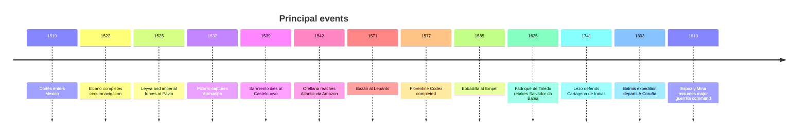

# Spanish Explorers and Military Leaders Who Reshaped the Early Modern World

iturn508391image1turn508391image0turn508391image2turn508391image3

## Executive summary

The fourteen figures examined here span roughly three centuries, from the formation of the early Spanish Atlantic empire to the Napoleonic Wars. Taken together, they illustrate several distinct mechanisms by which the Spanish Monarchy exercised global influence: coalition warfare, oceanic navigation, imperial administration, ethnographic knowledge production, amphibious operations, fortress defense, public-health logistics, and irregular warfare. The most important analytical point is that their achievements rarely resulted from individual action alone. Cortés depended fundamentally on Indigenous coalitions; Pizarro exploited an already destabilized Andean political order; Elcano completed a voyage initiated by Magellan and sustained by a multinational crew; Sahagún's great work was created with Nahua scholars and artists; Legazpi relied on Urdaneta and local alliances; Balmis's expedition depended on Isabel Zendal, José Salvany, medical personnel, officials and children who carried live vaccine. Modern scholarship increasingly treats these accomplishments as collective rather than solitary achievements. citeturn112145search0turn772780search2turn166324search0

The military commanders likewise reveal that Spanish power did not rest simply on the stereotypical *tercio* infantryman. Antonio de Leyva's defense of Pavia formed part of an integrated imperial army; Álvaro de Bazán excelled at naval concentration and amphibious warfare; Francisco de Sarmiento's Castelnuovo defense was tactically impressive but strategically futile; Francisco Arias de Bobadilla's survival at Empel depended partly on extraordinary environmental conditions later transformed into religious memory; Fadrique de Toledo's reconquest of Salvador da Bahia was a genuinely Iberian expedition involving Portuguese as well as Castilian resources; Blas de Lezo's defense of Cartagena was shared with Viceroy Sebastián de Eslava, engineers, regular troops, militia and colonial defenders; and Espoz y Mina transformed guerrilla bands into something approaching an organized regional military system. citeturn217468search2turn551882search3turn264657search0turn551882search1

Several popular narratives require correction. Cartagena de Indias was not simply "Blas de Lezo against England"; Tenochtitlan was not conquered by 500 Spaniards acting alone; the fall of the Inca state cannot be explained merely by firearms and horses; Elcano did not independently conceive the first circumnavigation; the *Florentine Codex* is not solely Sahagún's intellectual product; and the freezing at Empel is historically plausible while its miraculous interpretation belongs to a later devotional and military tradition. These qualifications do not diminish the protagonists' importance. They make their accomplishments historically intelligible. citeturn112145search4turn772780search7turn580493search0

The source base is unusually strong. Spain's PARES portal preserves or catalogs original correspondence, royal decrees, capitulations, expedition papers, testaments and military files; the Archivo General de Indias is particularly rich for Cortés, Pizarro, Elcano, Orellana, Legazpi, Balmis and Lezo. The Biblioteca Nacional de España, Museo Naval, Museo del Prado, Archivo General de Simancas, Archivo Histórico Nacional and international collections such as the Library of Congress and Biblioteca Medicea Laurenziana provide complementary evidence. The methodological emphasis in this report—primary records first, institutional sources second, scholarship third, legends explicitly separated from documentation—also follows the research standards set out in the supplied research brief. fileciteturn0file0

## Comparative table and chronology

| Name | Lifespan | Main role | Signature event(s) | Immediate outcome | Long-term impact |
|---|---:|---|---|---|---|
| Hernán Cortés | 1485–1547 | Conquistador, governor | Mexico campaign, 1519–1521 | Fall of Mexico-Tenochtitlan | Creation of New Spain; enormous demographic, political, religious and ecological transformation. citeturn592244search6turn112145search4 |
| Antonio de Leyva | 1480–1536 | Imperial commander | Defense/Battle of Pavia, 1524–1525 | French army defeated; Francis I captured | Strengthened Habsburg position in Italy; classic case of infantry-firepower integration. citeturn227618search5turn580493search4 |
| Francisco Pizarro | c.1475–1541 | Conquistador, governor | Cajamarca, 1532; Cuzco, 1533 | Atahualpa captured and executed; Inca political center seized | Foundation of Spanish Peru; enduring political and cultural transformation and colonial exploitation. citeturn592244search3turn592244search7 |
| Francisco de Sarmiento | c.1498–1539 | *Maestre de campo* | Castelnuovo, 1539 | Garrison destroyed after prolonged resistance | Became an archetype of the *tercio* last stand; strategically, the position was lost. citeturn217468search2turn217468search7 |
| Juan Sebastián Elcano | 1487–1526 | Navigator, captain | First circumnavigation, completed 1522 | *Victoria* reached Spain | Demonstrated a practicable global oceanic circuit and transformed geographical knowledge. citeturn687668search4turn687668search8 |
| Francisco de Orellana | 1511–1546 | Explorer, governor | Descent of Amazon, 1541–1542 | Reached Atlantic after crossing South America | First documented European navigation of most of the Amazon system; major geographical consequences. citeturn687668search1turn687668search5 |
| Bernardino de Sahagún | c.1499–1590 | Franciscan scholar | *Florentine Codex*, c.1540s–1577 | Vast bilingual encyclopedia compiled | Foundational source for Nahua history, language, religion and ethnography. citeturn772780search1turn772780search2 |
| Miguel López de Legazpi | c.1510–1572 | Governor, colonial commander | Cebu 1565; Manila 1571 | Durable Spanish base established in Philippines | Linked American and Asian imperial systems through Manila. citeturn687668search3turn687668search6 |
| Álvaro de Bazán | 1526–1588 | Admiral | Lepanto 1571; Terceira 1582–1583 | Major naval victories | Advanced Spanish amphibious and blue-water operational capability. citeturn227618search0turn580493search6 |
| Francisco Arias de Bobadilla | 1537–1610 | *Maestre de campo* | Empel, 1585 | Encircled troops escaped and counterattacked | Became central to Spanish infantry's institutional memory and devotion to the Immaculate Conception. citeturn551882search0turn580493search1 |
| Fadrique de Toledo Osorio | 1580–1634 | Admiral, captain general | Recapture of Bahia, 1625 | Dutch expelled from Salvador | Demonstrated Hispano-Portuguese amphibious coordination during the Iberian Union. citeturn551882search2turn551882search3 |
| Blas de Lezo | 1689–1741 | Lieutenant general, navy | Cartagena de Indias, 1741 | British expedition withdrew | Preserved a major Caribbean imperial hub during the War of Jenkins' Ear. citeturn264657search0turn264657search3 |
| Francisco Javier Balmis | 1753–1819 | Military physician | Royal Vaccine Expedition, 1803–1806/10 | Vaccination networks established across multiple continents | Landmark in transoceanic public-health organization and vaccine technology transfer. citeturn166324search1turn166324search8 |
| Francisco Espoz y Mina | 1781–1836 | Guerrilla commander, general | Navarra campaigns, 1810–1813 | Sustained disruption of French occupation | Important model of organized insurgency; later major figure in Spanish liberal politics. citeturn551882search1 |

## Exploration, conquest and knowledge

**Hernán Cortés — 1485–1547, Medellín, Extremadura; conquistador, later governor and captain-general of New Spain.** Cortés left Cuba in February 1519 in defiance of Governor Diego Velázquez's changing instructions, created a municipal government at Veracruz that provided a legalistic basis for claiming direct royal authority, and progressively built alliances with Totonac, Tlaxcalan and other Indigenous communities hostile to or politically independent of the Mexica imperial center. The familiar "500 Spaniards conquered an empire" formulation is therefore seriously misleading: UNAM historians emphasize that Indigenous alliances and Malintzin's diplomatic and linguistic mediation were indispensable. citeturn592244search6turn112145search0turn112145search2

His campaign had three decisive phases. First came diplomatic-military penetration from Veracruz to Tenochtitlan in 1519. Second came the occupation of the capital, seizure of Moctezuma, political breakdown and the disastrous Spanish-Indigenous allied retreat of 30 June–1 July 1520. Third came systematic preparation for reconquest: Cortés rebuilt his coalition, constructed brigantines with Indigenous labor and technical expertise, secured approaches to the Basin of Mexico and used combined lake-and-causeway operations during the 1521 siege. Tenochtitlan fell on 13 August 1521 after prolonged combat, hunger and epidemic disease. citeturn112145search5turn112145search7turn112145search4

Cortés's long-term impact was immense but morally inseparable from colonial violence. The conquest opened central Mexico to Spanish imperial government, Christianity, tribute extraction, encomienda labor regimes and transatlantic biological exchange. At the same time, Indigenous peoples remained active political actors rather than passive victims; Tlaxcalans, for example, subsequently used their alliance record to claim privileges from the Crown. Historiography has therefore shifted from "Spanish military genius" toward a multi-causal model emphasizing Indigenous politics, disease, coalition formation, translation, local knowledge and internal divisions within Mesoamerica. citeturn112145search1turn112145search4

**Primary and archival priorities:** Cortés's *Cartas de relación*, especially the Second Letter of 30 October 1520; AGI, PATRONATO,16,N.1,R.1 and associated Cortés correspondence; the 1522 Cromberger printing preserved digitally by the Library of Congress; the *Lienzo de Tlaxcala* tradition; Book XII of the *Florentine Codex*. citeturn592244search0turn592244search8turn112145search10turn772780search3  
**Further reading:** Matthew Restall, *Seven Myths of the Spanish Conquest*; Camilla Townsend, *Fifth Sun*; Susan Kellogg, *A Concise History of the Aztecs*; Federico Navarrete, work on Malintzin and Indigenous alliances.  
**Five archive/museum items to examine:** Cortés's 1522 letter at AGI; the first printed Second Letter; the early Tenochtitlan map accompanying European editions; *Lienzo de Tlaxcala* imagery; *Florentine Codex*, Book XII. citeturn592244search0turn592244search6turn772780search2

**Francisco Pizarro — c.1475–1541, Trujillo, Extremadura; conquistador, governor of New Castile.** After earlier expeditions along the Pacific coast, Pizarro secured royal authorization in the Capitulación de Toledo of 26 July 1529. That document is fundamental because it shows that the conquest was not merely an improvised private adventure: it was a Crown-sanctioned enterprise in which offices, jurisdictions and rewards were explicitly allocated. citeturn592244search3turn592244search4

The decisive event was Cajamarca on 16 November 1532. Pizarro's small expedition entered an Andean political world destabilized by civil war between Atahualpa and Huáscar and by epidemic disease. At Cajamarca, the Spaniards arranged an ambush in the central square and seized Atahualpa amid enormous violence. The emperor subsequently provided a vast ransom but was executed in 1533. Pizarro's coalition then moved toward Cuzco, exploiting rivalries among Andean elites and recruiting Indigenous auxiliaries. The "few Europeans versus millions of Incas" image therefore conceals the political fragmentation and local alliances that made the advance possible. Pizarro later founded Lima in 1535 as the administrative center of Spanish Peru. citeturn592244search3turn592244search7

The long-term effects were foundational for South American history: Spanish rule reorganized tribute, landholding, religion and labor; the Andean economy was eventually integrated into global silver circuits. The conquest also produced catastrophic warfare, forced labor, displacement, demographic loss and cultural destruction. Historiography continues to debate how much weight to assign to technology, disease, Inca factionalism, Indigenous coalition politics and Pizarro's tactical daring. The most useful modern approach is not to deny his audacity at Cajamarca, but to refuse to treat it as a self-sufficient explanation. citeturn592244search7

**Primary and archival priorities:** Capitulación de Toledo, AGI LIMA,565,L.1,F.16R-21V; duplicate capitulation in INDIFERENTE,415,L.1; Pizarro letters in PATRONATO,90B; Pedro del Barco petition with Pizarro's signed response, Library of Congress; contemporary narratives by Francisco de Xerez and Pedro Pizarro. citeturn592244search3turn592244search5turn592244search7turn592244search9  
**Further reading:** John Hemming, *The Conquest of the Incas*; R. Alan Covey, *Inca Apocalypse*; Terence D'Altroy, *The Incas*; Matthew Restall and Kris Lane, *Latin America in Colonial Times*.  
**Key objects:** Capitulación de Toledo; Pizarro's 1535 royal correspondence; Pedro del Barco petition; early Cuzco/Lima maps; surviving conquest-period Andean chronicles.

**Juan Sebastián Elcano — 1487–1526, Getaria; Basque mariner, master and later captain of the *Victoria*.** Elcano entered the Magellan expedition in 1519 as master of the *Concepción*, not as overall commander. After Magellan's death at Mactan and a sequence of command changes, Elcano became captain of the *Victoria*. By December 1521 he effectively led the homeward attempt westward across the Indian Ocean, around the Cape of Good Hope and north to Spain. The battered *Victoria* reached Sanlúcar on 6 September 1522. citeturn687668search0turn687668search8

The feat was strategically consequential because Elcano chose the dangerous Portuguese-controlled western return rather than retracing the Pacific route. The surviving crew thereby completed the first recorded circumnavigation. Elcano's own letter to Charles V immediately highlighted the voyage's extraordinary geographical significance, the discovery of the strait, arrival in the Moluccas and the successful circuit of the globe. He later joined the Loaísa expedition as pilot major and died in the Pacific on 4 August 1526. citeturn687668search4turn687668search9

The historiographical controversy concerns credit. Magellan conceived and commanded most of the expedition; Elcano completed it. Portuguese and Spanish national narratives have sometimes transformed a multinational expedition into competing national heroic stories. A rigorous interpretation gives both men distinct credit while remembering the dozens of European, Asian and African sailors whose labor made the voyage possible.

**Primary sources:** Elcano's 6 September 1522 letter, AGI PATRONATO,48,R.20; Antonio Pigafetta's account; Casa de la Contratación payroll and expedition records; Elcano's 1526 testament, AGI PATRONATO,38,R.1. citeturn687668search4turn687668search9  
**Further reading:** Felipe Fernández-Armesto, *Straits*; Laurence Bergreen, *Over the Edge of the World*; scholarly work by Pablo Emilio Pérez-Mallaína and RAH's Magellan-Elcano studies. citeturn508391search8  
**Objects:** Elcano letter; testament; *Victoria* documentation; contemporary route maps; commemorative material in Getaria and Spanish naval collections.

**Francisco de Orellana — 1511–1546, Trujillo; conquistador, explorer and later governor of Nueva Andalucía.** Orellana had served in Peru and Ecuador before joining Gonzalo Pizarro's 1541 expedition east of the Andes. When provisions collapsed, Orellana took a smaller party downstream in search of food. The current prevented a practical return, and the detachment continued along the Napo into the Amazon, eventually reaching the Atlantic in 1542. PARES records him subsequently receiving royal appointment as governor and captain-general of Nueva Andalucía on 17 February 1544. citeturn687668search1turn687668search5

The expedition's importance lies less in the traditional word "discovery"—millions of Indigenous people already knew and inhabited the river system—than in producing the first European eyewitness traversal of most of the Amazon basin. Friar Gaspar de Carvajal's account describes densely settled riverbanks, political communities, warfare, food systems and encounters that later observers sometimes dismissed as exaggeration. Archaeological research has increasingly shown that pre-contact Amazonia supported substantial populations and complex landscapes, making portions of Carvajal's testimony more plausible than older historiography assumed.

Orellana remains controversial because exploration was inseparable from conquest, territorial claims and violent encounters. His second expedition, intended to establish colonial rule, failed disastrously and he died in 1546. The romantic story that he "discovered the Amazon" therefore requires qualification: he navigated it for European imperial purposes and transmitted information into European geographical systems.

**Primary sources:** Gaspar de Carvajal, *Relación del nuevo descubrimiento del famoso río grande de las Amazonas*; Orellana's 1544 royal provision, AGI INDIFERENTE,416,L.2,F.6V-8V; litigation and testimony surrounding his separation from Gonzalo Pizarro. citeturn687668search5  
**Further reading:** Charles Mann, *1491* for the broader Amazonian demographic debate; modern critical editions of Carvajal; José Toribio Medina's documentary studies of Orellana.  
**Objects:** Carvajal manuscripts/copies; royal governorship decree; sixteenth-century Amazon maps; early printed geographical representations; PARES Orellana authority file. citeturn687668search1

**Bernardino de Sahagún — c.1499–1590, Sahagún, León; Franciscan missionary, teacher and compiler of the *Historia general de las cosas de Nueva España*.** Sahagún arrived in New Spain in 1529 and worked extensively with Indigenous students and elders, especially in Tlatelolco. Over decades he developed structured questionnaires, collected Nahuatl testimony, compared versions and collaborated with highly educated Nahua writers and painters. The final *Florentine Codex*, completed around 1577, consists of twelve books with parallel Nahuatl and Spanish texts and nearly 2,500 illustrations. citeturn687668search2turn772780search2turn772780search3

Calling Sahagún the "first anthropologist" is useful only with qualifications. His method—systematic interviews, linguistic work, comparison of testimony and attention to Indigenous categories—resembles later ethnography. But his principal religious purpose was missionary: understanding Nahua religion would help Christian evangelization eliminate it. The work simultaneously records and attacks the culture it documents. citeturn772780search3

Modern scholarship has also decisively moved away from treating the Codex as "Sahagún's book." The Getty's digital edition identifies Nahua collaborators including Antonio Valeriano, Alonso Vegerano, Martín Jacobita, Pedro de San Buenaventura and numerous artists. It is therefore better understood as a colonial knowledge-production project in which European and Indigenous intellectual traditions interacted under unequal political conditions. UNESCO inscribed Sahagún's materials in Memory of the World because of their exceptional value for Nahua language, history and culture. citeturn772780search1turn772780search4

**Primary sources:** *Florentine Codex*, Biblioteca Medicea Laurenziana, Ms. Mediceo Palatino 218–20; *Códices Matritenses* in Madrid; INAH manuscript holdings; Sahagún's prologues and questionnaires. citeturn772780search1turn772780search4  
**Further reading:** Arthur J. O. Anderson and Charles Dibble's 13-volume edition; Alfredo López Austin and Josefina García Quintana's edition; James Lockhart, *We People Here*; recent essays accompanying the Digital Florentine Codex. citeturn772780search4  
**Objects:** original Florentine Codex in Florence; Matritense manuscripts; INAH's later Florentine copy; Nahua illustrations; Tlatelolco archaeological and documentary materials. citeturn772780search0turn772780search2

**Miguel López de Legazpi — c.1510–1572, Zumarraga; colonial administrator, expedition commander and first Spanish governor/captain-general of the Philippines.** Legazpi spent decades in New Spain before receiving command of the 1564 expedition to the Philippines. His experience was administrative as much as military. The expedition reached Cebu in 1565 and established a durable Spanish base; Manila was occupied and founded as the main colonial capital in 1571. PARES identifies Legazpi as the first captain-general of the islands. citeturn687668search3

His most consequential achievement cannot be separated from Andrés de Urdaneta, whose successful eastbound *tornaviaje* to New Spain solved the fundamental logistics problem of sustaining the colony. Legazpi's forces combined negotiation, alliances, tribute demands, coercion and warfare. His correspondence with Portuguese commander Gonzalo Pereira reveals the legal and geopolitical tension created by rival Iberian claims to the region. citeturn687668search6

The long-term consequence was the Manila-centered trans-Pacific system connecting Chinese and Southeast Asian commerce with American silver and, indirectly, European markets. Politically, however, this was also the beginning of more than three centuries of Spanish colonial rule in much of the Philippine archipelago. Filipino historiography therefore reads Legazpi both as an architect of a global commercial connection and as a colonial conqueror whose regime reordered local sovereignty.

**Primary sources:** Legazpi-Pereira correspondence, AGI PATRONATO,24,R.9; Legazpi's letters requesting munitions and reinforcement; royal instructions for the expedition; Urdaneta's navigation reports. citeturn687668search6turn687668search7  
**Further reading:** William Henry Scott, *Barangay*; John Leddy Phelan, *The Hispanization of the Philippines*; Manel Ollé's work on early modern Manila and East Asia.  
**Objects:** Legazpi correspondence; early Manila maps; Cebu foundation documents; Urdaneta route records; Santo Niño-related early colonial material in Cebu.

## Habsburg soldiers and admirals

**Antonio de Leyva — 1480–1536, Leyva, La Rioja; imperial captain, later governor and captain-general of Milan.** Leyva was an experienced Italian Wars commander whose defining role came during the French siege of Pavia in 1524–1525. He commanded the imperial garrison while a relieving army approached. Despite shortages and pressure from Francis I's army, the garrison remained operational long enough for the imperial forces to coordinate the decisive battle of 24 February 1525. citeturn227618search5turn580493search4

The battle demonstrated the increasing battlefield importance of disciplined infantry and firearms against traditional heavy cavalry. Spanish and German arquebusiers, Landsknechts and other imperial contingents operated within a combined-arms force. Francis I was captured and the French army suffered a catastrophic defeat. Leyva's greatest contribution was not a single cinematic charge but the operational endurance of his garrison and its participation in the broader imperial plan. citeturn580493search4

Pavia accelerated Habsburg dominance in Italy, although it did not permanently settle the Franco-Habsburg rivalry. Leyva eventually became one of Charles V's principal commanders and governor of Milan. Nationalist narratives sometimes label Pavia a purely "Spanish victory"; in reality it was an imperial victory achieved by a multinational Habsburg army.

**Primary/archival:** AGS Consejo de Guerra materials; Leyva correspondence in GYM,LEG,6 for 1533–1535; imperial dispatches from the Italian Wars. citeturn227618search4  
**Further reading:** Angus Konstam, studies of Pavia; Charles Oman's histories of sixteenth-century warfare; Geoffrey Parker on the military revolution.  
**Objects:** contemporary Pavia battle art; Leyva correspondence; arms and arquebuses in Spanish/Italian military museums; Francis I captivity documentation; imperial campaign maps.

**Francisco de Sarmiento — c.1498–1539, probably Burgos; *maestre de campo* and commander of the Spanish garrison at Castelnuovo.** Castelnuovo, modern Herceg Novi in Montenegro, had been seized by Holy League forces in 1538. After the Christian naval defeat at Preveza left the position exposed, Sarmiento commanded roughly 3,500–4,000 Spanish soldiers facing Khayr al-Din Barbarossa's much larger Ottoman force. Modern figures for Ottoman strength vary considerably and should not be treated as precise; contemporary and later sources consistently agree on overwhelming numerical superiority. citeturn217468search1turn217468search6

The siege ran from 18 July to 7 August 1539. Sarmiento's men used sorties, arquebus fire, fortifications and aggressive night actions rather than passive defense. A contemporary relation by squad leaders Juan de Alcaraz and Juan de Tapia records an Ottoman offer allowing the garrison to leave and receive payment; the defenders rejected it. Following intense bombardment, repeated assaults and collapse of the fortifications, almost the entire garrison was killed or captured. Sarmiento died fighting. citeturn217468search2turn217468search6

Militarily, Castelnuovo was a defeat. Its defenders delayed and bloodied the Ottoman force but failed to preserve the position or reverse Ottoman maritime superiority. The event subsequently acquired enormous symbolic importance as a story of collective courage and refusal to surrender. Even sympathetic scholarship notes the obvious strategic question: whether sacrificing the garrison was worth the cost. citeturn217468search7

**Primary sources:** Alcaraz and Tapia, *Relación del asedio y toma de Castelnuovo*, preserved in the Archivo de los Duques de Alba; Martín García de Cerezeda, *Tratado de las campañas*; imperial correspondence; Ottoman accounts. citeturn217468search2  
**Further reading:** José M. Floristán's critical edition; Manuel Fernández Álvarez on Charles V; Gennaro Varriale on Mediterranean intelligence and war.  
**Objects:** Alba archive relation; sixteenth-century Adriatic maps; contemporary Ottoman-Christian naval imagery; Spanish *tercio* weaponry; Castelnuovo fortification remains.

**Álvaro de Bazán — 1526–1588, Granada; first marquis of Santa Cruz, captain-general of the Ocean Sea and one of Philip II's principal naval commanders.** Bazán's career ranged across the Mediterranean and Atlantic. At Lepanto in 1571 he commanded the reserve squadron and used it to reinforce threatened sectors during the battle. His most independent operational achievement came in the Azores, especially Terceira in 1582–1583, where he defeated a Franco-Portuguese fleet and followed the naval victory with an amphibious campaign that completed Philip II's consolidation of the Portuguese succession. citeturn227618search0turn580493search6

Bazán's importance rests particularly on integration of fleet combat, troop transport, shore assault and logistics. His campaigns show that Spanish naval power at its height was not merely galley warfare in the Mediterranean but increasingly included Atlantic operations involving sailing warships, artillery and coordinated amphibious forces. Recent Spanish naval scholarship continues to treat Terceira as an important case study in amphibious operational leadership. citeturn580493search6

His reputation has also been distorted by the Armada of 1588. Bazán participated in planning an invasion of England but died in Lisbon on 9 February 1588 before the Armada sailed. It is therefore speculative to argue that his survival would necessarily have produced victory. His genuine record is impressive enough without counterfactual mythology. citeturn227618search0

**Primary/archival:** Bazán papers and royal correspondence in Simancas; PARES authority file linked to archival materials; campaign dispatches; naval records relating to the Azores. citeturn227618search0  
**Further reading:** 2026 *Revista General de Marina* Álvaro de Bazán issue; Agustín Ramón Rodríguez González on Spanish naval history; Geoffrey Parker on Philip II's grand strategy. citeturn580493search6  
**Objects:** Palace-Archive of the Marquises of Santa Cruz at Viso del Marqués; Terceira campaign maps; Lepanto visual material; Bazán portraiture; naval artillery and model ships in Museo Naval collections.

**Francisco Arias de Bobadilla — 1537–1610, Madrid region; nobleman, cavalry officer and *maestre de campo*.** Bobadilla served in Mons, Maastricht, Portugal and the Azores before commanding troops in the Netherlands. His name is inseparable from the "Miracle of Empel" of 7–8 December 1585. His *tercio*, traditionally given as about 5,000 men, was isolated on Bommel by Dutch forces that deliberately flooded the terrain by opening dikes. citeturn551882search0turn580493search9

According to the Spanish military tradition, soldiers digging defensive positions found an image of the Immaculate Conception. During the night the waters froze, immobilizing or endangering the Dutch vessels and allowing Spanish troops to move across the ice and counterattack. The immediate result was the escape of Bobadilla's force and a striking tactical reversal. citeturn580493search0turn580493search2

Three levels of historical claim must be separated. **Verified:** Bobadilla's troops were trapped by flooding, cold weather altered the tactical situation, and the Spanish force escaped and attacked. **Traditional but plausible:** discovery of a Marian image during entrenchment. **Devotional interpretation:** divine intervention caused the freeze and victory. The last belongs to religious belief and institutional memory rather than empirically demonstrable military history. The Immaculate Conception became officially patroness of Spanish infantry only in 1892, although the Empel tradition had been associated with infantry for centuries. citeturn580493search1

**Primary/archival:** Bobadilla papers accessible through PARES-associated collections; contemporary Netherlandish and Spanish war correspondence; chronicles of the Army of Flanders. citeturn551882search0  
**Further reading:** Geoffrey Parker, *The Army of Flanders and the Spanish Road*; Fernando Martínez Laínez, studies of the Tercios; scholarship on the Dutch Revolt.  
**Objects:** Empel commemorative paintings at the Spanish Infantry Academy; sixteenth-century Bommel maps; Army of Flanders muster records; Marian devotional imagery; Bobadilla genealogical/military records. citeturn580493search2

**Fadrique de Toledo Osorio — 1580–1634, Naples; first marquis of Villanueva de Valdueza, captain-general of the Armada del Mar Océano and Portuguese military forces.** His greatest campaign was the recovery of Salvador da Bahia in 1625 after the Dutch West India Company seized the capital of Portuguese Brazil in 1624. Madrid and Lisbon mobilized a large combined expedition whose size, complexity and transatlantic supply requirements made it one of the most significant amphibious operations of the seventeenth-century Iberian world. citeturn551882search2turn551882search4

The allied fleet crossed the Atlantic, blockaded Salvador and landed troops to besiege the Dutch garrison. On 1 May 1625 the defenders capitulated. The event mattered strategically because Bahia was both the administrative center of Portuguese America and a critical node in Atlantic sugar and slave-trading networks. The victory became one of the celebrated events of Philip IV's *annus mirabilis* of 1625. citeturn551882search3

The campaign also illustrates why "Spanish victory" can be anachronistically narrow: Portugal remained under the same Habsburg monarch but retained separate institutions, and Portuguese ships, troops, merchants and interests were fundamental. Later court culture converted the operation into royal propaganda. Juan Bautista Maíno's *Recapture of Bahía* depicts Fadrique magnanimously presenting royal mercy to the defeated Dutch, but the Prado explicitly notes that this particular scene does not occur in the historical accounts and derives from theatrical-literary invention. citeturn551882search5

**Primary sources:** Bartolomeu Guerreiro, *Jornada dos vassalos da coroa de Portugal*; Francisco de Avendaño y Vilela's relation of the expedition; Portuguese Arquivo Histórico Ultramarino Bahia files; Spanish royal correspondence. citeturn551882search4  
**Further reading:** Stuart B. Schwartz on Habsburg Brazil; José Manuel Santos Pérez on Bahia; studies associated with the Prado's Salón de Reinos project. citeturn551882search3  
**Objects:** Maíno's *The Recapture of Bahía*, Museo del Prado; archival AHU Bahia documents; contemporary battle engravings; fleet lists; maps of Salvador's fortifications. citeturn551882search5

## Bourbon naval power, public health and the Napoleonic crisis

**Blas de Lezo — 1689–1741; Basque naval officer, lieutenant general of the Real Armada.** Lezo accumulated serious combat injuries during the War of the Spanish Succession and later campaigns, eventually losing the use of a leg, an eye and an arm. His historical significance, however, should rest on command rather than disability. In 1737 he assumed command responsibilities at Cartagena de Indias, one of the key fortified ports of the Spanish Caribbean. citeturn264657search3turn264657search5

The 1741 British expedition under Admiral Edward Vernon was extraordinarily large. Exact force totals vary depending on whether one counts transports, auxiliary vessels, colonial troops and sailors, so spectacular numbers frequently repeated in popular history should be treated cautiously. What is beyond dispute is overwhelming British naval superiority. Lezo commanded only six major Spanish warships at Cartagena, while the defense also depended on fortifications, regular infantry, militia, artillery, engineers and Viceroy Sebastián de Eslava. citeturn264657search0turn264657search3

Lezo's defensive method was layered rather than purely naval. Ships and batteries contested harbor approaches; vessels were eventually sunk or sacrificed to obstruct channels; forts forced the British to spend time and manpower reducing successive defensive lines; and the decisive failure occurred when British land forces could not successfully carry the inner defenses around San Felipe de Barajas. Tropical disease devastated the attackers and was at least as important as combat losses. By May the British withdrew. citeturn264657search0turn264657search4

The main historiographical controversy is allocation of credit. Modern Spanish popular memory often makes Lezo the sole mastermind and Eslava an obstacle. The documentary record is messier: Lezo and Eslava quarreled, but both exercised essential authority. The victory was collective. Claims that Cartagena was categorically "the greatest British naval defeat in history" are rhetorical rather than analytically useful because comparisons across centuries depend on criteria. citeturn264657search7

**Primary sources:** Lezo's own letter and diary, AHN ESTADO,2335,Exp.2; AGI SANTA_FE,1021, 427 folios of his correspondence; Carlos Desnaux's detailed siege diary; British Admiralty/Vernon correspondence. citeturn264657search0turn264657search1turn264657search4  
**Further reading:** Mariela Beltrán and Carolina Aguado, *La última batalla de Blas de Lezo*; naval histories published by the Instituto de Historia y Cultura Naval; studies of the War of Jenkins' Ear. citeturn264657search7  
**Objects:** Lezo portrait and exhibition materials, Museo Naval; his correspondence; Desnaux diary; Cartagena fortifications and Castillo San Felipe de Barajas; British commemorative medals struck prematurely for an expected Vernon victory.

**Francisco Javier Balmis — 1753–1819, Alicante; military surgeon and physician to Charles IV.** Balmis's most consequential achievement was not inventing vaccination—Edward Jenner had demonstrated cowpox vaccination earlier—but creating and directing a large state-sponsored system for transporting viable vaccine across oceans. In 1803 Charles IV authorized the Real Expedición Filantrópica de la Vacuna. The *María Pita* left A Coruña on 30 November with medical staff, Isabel Zendal and 22 children who maintained the vaccine through successive arm-to-arm inoculations. citeturn166324search0turn166324search5

This was a remarkable logistical response to a pre-refrigeration problem. Dried or preserved vaccine material could lose potency during long tropical voyages, so the expedition created a living biological chain. The party crossed the Atlantic, operated in the Caribbean and mainland Spanish America, and divided in Venezuela: Balmis proceeded through Cuba and Mexico to the Philippines and later Macao and Canton, while José Salvany carried the campaign through much of South America and died during the mission. The broader expedition continued until 1810, and Balmis himself later returned to America. citeturn166324search1turn166324search8

Its significance was institutional as much as medical. Balmis intended not simply to vaccinate individuals but to create local vaccination boards, train practitioners and establish mechanisms that would perpetuate the vaccine after the expedition departed. A surviving 1805 Manila file shows the practical and ethical tensions: Balmis complained about the treatment, food and accommodation of the children carrying the vaccine. citeturn166324search2

The expedition is often celebrated as the first international vaccination campaign, a characterization supported by modern medical historians, but humanitarian praise should not erase the ethical problem of using institutionalized children as biological carriers within an imperial hierarchy. Their participation was indispensable and deserves as much attention as Balmis's direction. citeturn166324search8

**Primary sources:** AHN and AGI Expedición Balmis collections, now grouped in Spain's documentary heritage initiatives; FILIPINAS,915,N.25; the royal instructions; contemporary newspaper notices in *Diario de Madrid* and *Mercurio de España*; Balmis correspondence. citeturn166324search1turn166324search2turn166324search5  
**Further reading:** José Tuells and Susana Ramírez, *Balmis et Variola*; medical-history literature on the Royal Vaccine Expedition; studies of Isabel Zendal and José Salvany.  
**Objects:** BNE lithograph of the expedition; royal expedition papers; ship documentation for *María Pita*; vaccination instruments and manuals; archival correspondence concerning the children. citeturn166324search5

**Francisco Espoz y Mina — 1781–1836, Idocin, Navarre; guerrilla commander, later regular general and captain-general.** Espoz entered the anti-French insurgency during the Peninsular War and rose to command after his nephew Javier Mina was captured. Between 1810 and 1813 he built one of the most effective guerrilla organizations in northern Spain, conducting operations across Navarre, Aragón, Castile and Gipuzkoa. citeturn551882search1

His significance lies in organization. Rather than treating guerrilla warfare as spontaneous bands of peasants attacking isolated patrols, Espoz imposed hierarchy, discipline, intelligence networks, taxation and logistical arrangements. His forces attacked communications, couriers, garrisons and convoys, forcing French troops to devote disproportionate manpower to route protection. The strategic effect was cumulative: guerrillas could not defeat Napoleon's armies alone, but they made occupation far more expensive and helped complement Anglo-Portuguese and Spanish regular operations.

Espoz's later career makes him especially important to nineteenth-century political history. He supported constitutional liberalism, attempted a failed rising in Pamplona in 1814, fled to France, returned after the Liberal Revolution of 1820 and held senior commands. He thus illustrates the transformation of Napoleonic guerrilla commanders into politically engaged officers during Spain's prolonged struggle between absolutism and constitutionalism. citeturn551882search1

Historiography once romanticized guerrillas as a unified national uprising. Modern work emphasizes local loyalties, coercive recruitment, requisitioning, banditry, political differences and the crucial role of regular Allied armies. Espoz remains exceptional, but his success should not be generalized to every guerrilla unit.

**Primary sources:** Espoz y Mina's *Memorias*; military and administrative records in the Archivo Real y General de Navarra; French occupation reports; RAH holdings and editions of his memoirs. citeturn580493search7turn551882search1  
**Further reading:** Charles Esdaile on the Peninsular War and Spanish guerrillas; Ronald Fraser, *Napoleon's Cursed War*; Espoz y Mina's own memoirs, read critically against French sources.  
**Objects:** Espoz portrait and papers in Navarra; guerrilla correspondence; French operational maps; proclamations from his later liberal career; military decorations and personal effects associated with his generalship.

## Cross-cutting interpretation and research priorities

The strongest common pattern is **adaptation under constraint**. Cortés transformed a numerically tiny expedition into a coalition army; Elcano chose a hazardous route home when the original command structure had collapsed; Orellana converted an emergency food-search mission into a continental river descent; Legazpi paired colonization with a trans-Pacific communications problem; Leyva survived a siege long enough for a relieving army to act; Sarmiento repeatedly counterattacked despite strategic isolation; Bobadilla exploited an extraordinary weather change; Bazán integrated fleet and landing forces; Toledo coordinated two imperial administrative systems; Lezo converted geography and fortification depth into strategic time; Balmis solved a biological preservation problem using human transmission; and Espoz created administration out of insurgency. These were less examples of individual "genius" in the romantic sense than of decision-making inside networks of soldiers, pilots, Indigenous allies, engineers, sailors, interpreters, bureaucrats and medical workers. citeturn112145search5turn687668search6turn166324search2

A second pattern is that **operational success and moral legitimacy are different questions**. Cortés and Pizarro were exceptionally effective political-military entrepreneurs, but their victories initiated systems involving conquest, coercion and exploitation. Legazpi established a durable imperial bridge to Asia, but that success inaugurated colonial domination. Sahagún preserved irreplaceable Nahua knowledge while participating in a missionary project designed to suppress Indigenous religion. Sarmiento's heroism did not make Castelnuovo strategically rational. Lezo's military skill does not require exaggerating British casualties or erasing Eslava. Balmis's humanitarian objective coexisted with ethically troubling dependence on institutionalized children. A serious history can acknowledge tactical intelligence and courage while also analyzing the violence, hierarchy and coercion within which they operated. citeturn772780search3turn264657search7turn166324search8

A third pattern is **the importance of archival survival in shaping fame**. Elcano's own 1522 letter makes his role unusually tangible; Lezo's surviving correspondence allows his disputes with Eslava to be reconstructed; the Castelnuovo relation by two squad leaders lets historians compare later heroic legend with near-contemporary testimony; and the Digital Florentine Codex now allows scholars to identify Nahua intellectual collaborators previously obscured by the shorthand label "Sahagún." Digitization by PARES, the Getty, INAH, the Library of Congress and Spanish museums is changing not only access to these figures but also their historiography. citeturn687668search4turn264657search1turn217468search2turn772780search2

For a deeper archival project, the highest-value collections are the **Archivo General de Indias in Seville** for Cortés, Pizarro, Elcano, Orellana, Legazpi, Balmis and Lezo; the **Archivo General de Simancas** for imperial commanders such as Leyva and Bazán; the **Archivo Histórico Nacional** for Lezo and vaccine records; the **Archivo de los Duques de Alba** for Castelnuovo; the **Biblioteca Medicea Laurenziana** and **Biblioteca de la Real Academia de la Historia** for Sahagún-related material; the **Arquivo Histórico Ultramarino** in Lisbon for the Bahia campaign; and the **Archivo Real y General de Navarra** for Espoz y Mina. PARES should be the starting portal because its authority records connect individuals to distributed archival descriptions rather than merely offering secondary biographies. citeturn687668search4turn227618search4turn264657search0turn166324search1turn551882search4

The most promising subjects for further revisionist research are **Sahagún**, because scholarship is still recovering the identities and intellectual roles of his Nahua collaborators; **Orellana**, because Amazonian archaeology continues to change how Carvajal's descriptions are evaluated; **Bobadilla**, because the devotional tradition of Empel needs stricter separation from contemporary documentation; **Lezo**, because modern popular mythology often outruns the archive; and **Balmis**, because the expedition can be reconstructed simultaneously as a public-health breakthrough, imperial administrative project and history of vulnerable children whose role has only recently received proportional attention. In each case, the most interesting history appears precisely where heroic memory, archival evidence and modern ethical interpretation do not perfectly coincide. citeturn772780search4turn580493search0turn264657search7turn166324search2